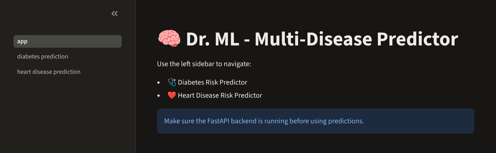
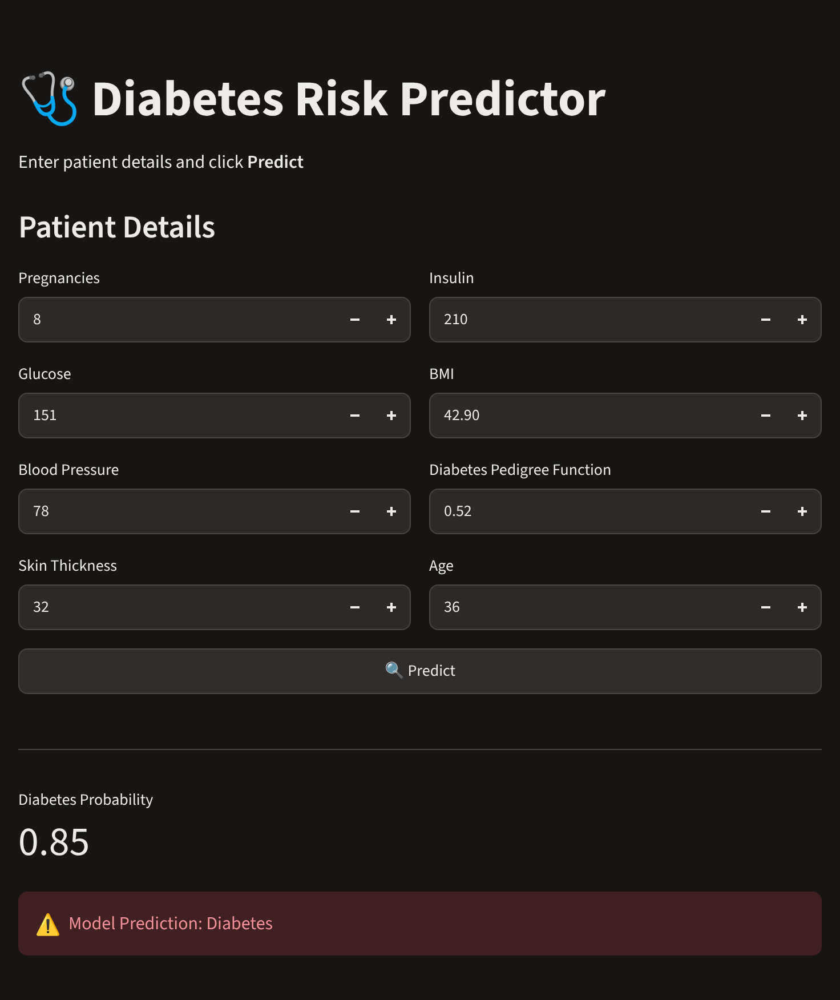
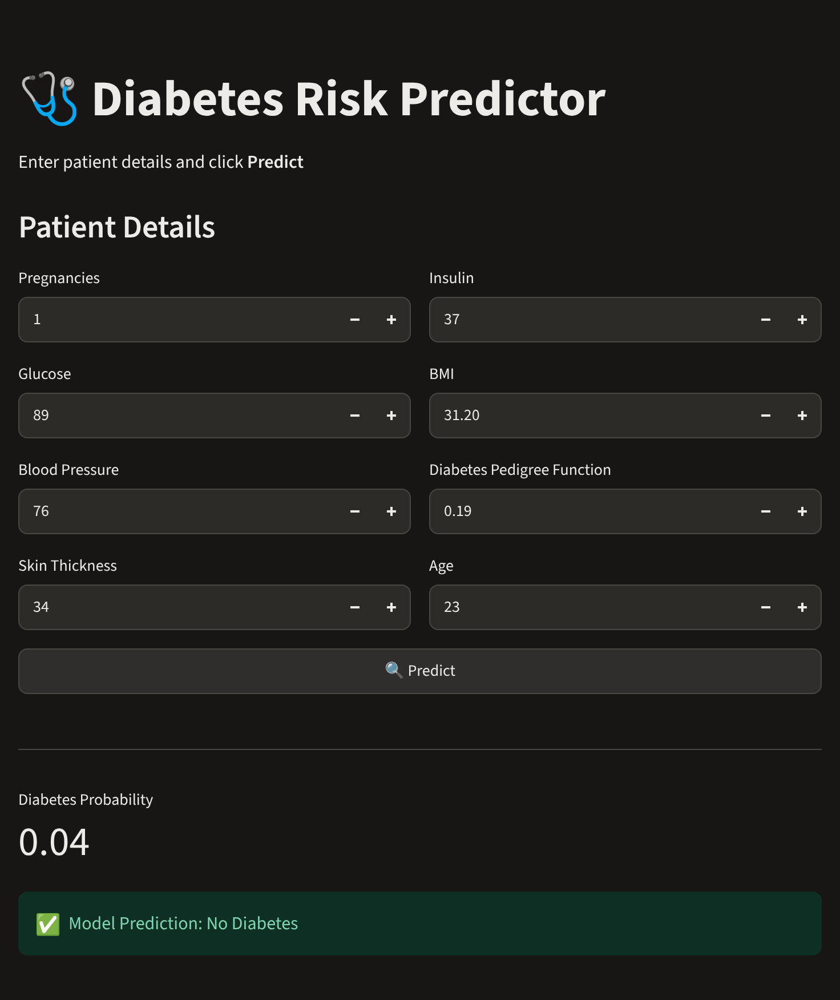

# Dr.ML - Multi-Disease Predictor

This project predicts if a patient is likely to have **diabetes** or **heart disease**. It has two trained models, a FastAPI backend and a Streamlit web app.

It is a learning project on two small public datasets. It is not a medical tool, and the predictions are not a diagnosis.

## What the project does

You open the page of a disease and enter the patient's values (8 values for diabetes, 13 for heart disease). The model returns the result and the probability of the disease.

- **Notebooks:** one per disease with EDA, cleaning, baseline, comparing four models, tuning and evaluation.
- **Models:** `SVC` for diabetes and `Random Forest` for heart disease. Each one is saved as a single scikit-learn pipeline, so the preprocessing travels with the model.
- **API:** FastAPI service with one predict route for both diseases. It checks the input types and returns the disease, the prediction and the probability.
- **Web app:** Streamlit app with a home page and one page per disease. Each page calls the API and shows the result.

## Demo

Open a disease page, fill in the form and click **Predict**. The app shows the probability of the disease and a red message (disease) or a green message (no disease). A value close to 1 means disease and a value close to 0 means no disease.

<p align="center">
  
</p>

<table>
  <tr>
    <td align="center" width="50%"></td>
    <td align="center" width="50%"></td>
  </tr>
  <tr>
    <td align="center"><sub><b>Diabetes</b> - probability 0.85</sub></td>
    <td align="center"><sub><b>No diabetes</b> - probability 0.04</sub></td>
  </tr>
  <tr>
    <td align="center"></td>
    <td align="center"></td>
  </tr>
  <tr>
    <td align="center"><sub><b>Heart disease risk detected</b> - probability 0.95</sub></td>
    <td align="center"><sub><b>Low risk</b> - probability 0.03</sub></td>
  </tr>
</table>

The values used in these screenshots are listed in [Getting started](#getting-started), step 6.

## How the parts fit together

```text
Streamlit app (src/frontend/app.py and pages/)
      |  POST /api/predict   {"disease": ..., "features": {...}}
      v
FastAPI (src/backend/main.py -> api/routes.py)
      |
      v
services/predictor.py  -> builds one input row -> trained pipeline (model_dir/*.joblib)
```

Both models are loaded once when the API starts, so each request only pays for the prediction. Every prediction is also written to `logs/app.log`.

## Steps of the project

Steps 1 to 9 are in the notebooks (section numbers in brackets, both notebooks use the same order). Steps 10 to 13 turn that work into a running app.

| # | Step | What happens |
| :---: | --- | --- |
| 1 | Load the data (§2) | `diabetes.csv` has 768 rows and 9 columns. `heart.csv` has 1,025 rows and 14 columns. |
| 2 | Check and clean (§3) | Neither file has empty cells. In the diabetes data a `0` is used for a missing value in five columns (Glucose 5 rows, BloodPressure 35, SkinThickness 227, Insulin 374, BMI 11), while the zeros in Pregnancies are real. There are no duplicate rows. The heart data has 723 duplicate rows (only 302 different rows), which are kept on purpose. |
| 3 | Explore (§3) | The class balance (65% / 35% for diabetes, 51% / 49% for heart), histograms, box plots and a correlation heatmap. There are no strongly correlated columns in either file. |
| 4 | Pre-process and split (§4) | **Diabetes:** `0` becomes missing in the five columns, missing values are filled with the median and everything is scaled. Stratified 80/20 split with `random_state=42` (614 train, 154 test). **Heart:** only scaling, because the categories are already numbers. `GroupShuffleSplit` 85/15 on a hash of each row, so identical rows never end up on both sides (869 train, 156 test). |
| 5 | Baseline (§5) | A scaled Logistic Regression gets 70.8% test accuracy for diabetes (it finds only half of the diabetic rows, recall 0.50) and 83.3% for heart disease. |
| 6 | Compare four models (§6) | Logistic Regression, SVC (SVM), Random Forest and XGBoost with 5-fold cross-validation on the training set. The diabetes models use class weights. The heart folds are `StratifiedGroupKFold`, so identical rows stay together. SVC has the best F1 for diabetes and Random Forest for heart disease. |
| 7 | Tune the best model (§6) | **Diabetes:** `GridSearchCV` over `C` and `gamma` (25 pairs, 125 fits) gives `C=1` and `gamma=scale`. **Heart:** `RandomizedSearchCV` with 60 candidates (300 fits), scored on macro F1, gives 1,119 trees and `max_depth=5`. |
| 8 | Retrain and test (§7, §8) | The diabetes SVC gets 72.7% accuracy on the notebook test set (154 rows). The heart Random Forest gets 81.4% (156 rows). Both are shown with a classification report. |
| 9 | Try predictions (§9) | `predict_diabetes()` and `predict_heart_disease()` are tried on one positive and one negative test row each and give the right answer every time. The heart function gives 96.5% and 28.5% disease probability. |
| 10 | Move the code to scripts | `src/training/diabetes.py` and `heart_disease.py` repeat the split and the final training with the settings from `.env` and `best_hyperparameters.yaml`, and save each pipeline with `joblib`. `src/common/preprocessing_util.py` holds the zero-to-missing step. |
| 11 | Build the API | FastAPI with `/api/health` and `/api/predict` in `src/backend`. `predictor.py` loads both models once and scores each request. |
| 12 | Build the web app | Streamlit home page and one page per disease in `src/frontend`. Each page calls the API. |
| 13 | Deploy | `deploy_drml.sh` sets up an AWS EC2 server and starts both services in the background. |

## Folder structure

```text
Dr.ML-Multi-Disease-Predictor/
├── Notebook_dir/
│   ├── 1_diabetes_prediction_using_ml.ipynb
│   └── 2_heart_disease_prediction_with_ml.ipynb
├── dataset/
│   ├── diabetes.csv                 # 768 rows x 9 columns
│   └── heart.csv                    # 1,025 rows x 14 columns
├── model_dir/
│   ├── diabetes_prediction_pipeline.joblib
│   └── heart_disease_prediction_pipeline.joblib
├── src/
│   ├── backend/
│   │   ├── main.py                  # FastAPI app
│   │   ├── api/routes.py            # /api/health and /api/predict
│   │   ├── schemas/prediction_schema.py
│   │   ├── services/predictor.py    # loads both models once and scores requests
│   │   └── config/settings.py
│   ├── frontend/
│   │   ├── app.py                   # Streamlit home page
│   │   ├── pages/                   # diabetes_prediction.py, heart_disease_prediction.py
│   │   └── config/settings.py
│   ├── training/
│   │   ├── diabetes.py              # trains and saves the diabetes model
│   │   ├── heart_disease.py         # trains and saves the heart disease model
│   │   └── config/                  # settings.py, best_hyperparameters.yaml
│   └── common/preprocessing_util.py
├── assets/screenshots/              # screenshots used in this README
├── env_template.txt                 # template for your local .env file
├── deploy_drml.sh                   # EC2 deploy script
├── deployment_steps.txt             # EC2 commands
├── requirements.txt
└── README.md
```

## Dataset

**Diabetes** (`dataset/diabetes.csv`) has 768 rows and 9 columns. There are no empty cells and no duplicate rows, but a `0` is used when a value is missing. The classes are imbalanced: 500 not diabetic and 268 diabetic (about 35% diabetic).

| Column | Meaning | Used by the model |
| --- | --- | --- |
| `Pregnancies` | Number of pregnancies (a `0` is a real value) | Yes |
| `Glucose` | Glucose level (a `0` means missing) | Yes |
| `BloodPressure` | Blood pressure (a `0` means missing) | Yes |
| `SkinThickness` | Skin fold thickness (a `0` means missing) | Yes |
| `Insulin` | Insulin level (a `0` means missing) | Yes |
| `BMI` | Body mass index (a `0` means missing) | Yes |
| `DiabetesPedigreeFunction` | Score of diabetes in the family history | Yes |
| `Age` | Age in years | Yes |
| `Outcome` | `1` = diabetic, `0` = not diabetic, this is the **label** | Target |

The zeros that mean "missing" are very common: 49% of the rows have no Insulin value and 30% have no SkinThickness value. The model turns them into missing values and fills them with the median of the training data.

**Heart disease** (`dataset/heart.csv`, from [Kaggle](https://www.kaggle.com/datasets/johnsmith88/heart-disease-dataset/data)) has 1,025 rows and 14 columns. There are no empty cells. The classes are almost even: 526 with heart disease and 499 without (about 51% / 49%).

| Column | Meaning | Used by the model |
| --- | --- | --- |
| `age` | Age of the patient in years | Yes |
| `sex` | `1` = male, `0` = female | Yes |
| `cp` | Chest pain type (0 to 3) | Yes |
| `trestbps` | Resting blood pressure (mm Hg) | Yes |
| `chol` | Serum cholesterol (mg/dl) | Yes |
| `fbs` | Fasting blood sugar above 120 mg/dl (`1` = true, `0` = false) | Yes |
| `restecg` | Resting electrocardiographic result (0 to 2) | Yes |
| `thalach` | Maximum heart rate reached | Yes |
| `exang` | Exercise induced angina (`1` = yes, `0` = no) | Yes |
| `oldpeak` | ST depression caused by exercise | Yes |
| `slope` | Slope of the peak exercise ST segment (0 to 2) | Yes |
| `ca` | Number of major vessels coloured by fluoroscopy (0 to 4) | Yes |
| `thal` | `0` = normal, `1` = fixed defect, `2` = reversible defect, `3` = unknown | Yes |
| `target` | `1` = heart disease, `0` = no heart disease, this is the **label** | Target |

**Duplicates.** 723 rows are exact copies of another row, so there are only 302 different rows. They are not dropped, because they can be different patients with the same measurements, and dropping them would change how often each case appears. Instead, the split and the cross-validation keep identical rows together, so that a copy of a training row is never used for testing.

All inputs of both files are used. No column is left out.

## Model and results

**Diabetes pipeline:** `0` to missing in five columns, median fill and `StandardScaler`, then `SVC` (RBF kernel, `C=1.0`, `gamma=scale`, `class_weight=balanced`, `probability=True`).

**Heart disease pipeline:** `StandardScaler`, then `RandomForestClassifier` (1,119 trees, `max_depth=5`, `min_samples_split=30`, `min_samples_leaf=11`, `max_features=sqrt`, `max_samples=0.6`, `ccp_alpha=0.0017`).

These settings are stored in `src/training/config/best_hyperparameters.yaml`.

**Model selection.** Four models were compared in each notebook with 5-fold cross-validation on the training set. The numbers are the mean of the five folds, and the disease class is the positive class.

| Diabetes model | CV recall (mean) | CV F1 (mean) |
| --- | :---: | :---: |
| **Support Vector Classifier** | **0.762** | **0.690** |
| Logistic Regression | 0.700 | 0.672 |
| Random Forest | 0.590 | 0.634 |
| XGBoost | 0.630 | 0.618 |

| Heart disease model | CV recall (mean) | CV F1 (mean) |
| --- | :---: | :---: |
| **Random Forest** | **0.878** | **0.836** |
| Logistic Regression | 0.858 | 0.820 |
| XGBoost | 0.846 | 0.804 |
| Support Vector Machine | 0.802 | 0.776 |

**Tuning.** For diabetes, `GridSearchCV` (5-fold, scored on F1) tried `C` in `[0.1, 1, 10, 100, 1000]` and `gamma` in `[0.001, 0.01, 0.1, 1, scale]`. The best pair was `C=1` and `gamma=scale` (CV F1 0.690). For heart disease, `RandomizedSearchCV` (60 candidates, 5-fold, scored on macro F1) searched the number of trees (400 to 1,200), `max_depth` (3 to 6), `min_samples_split`, `min_samples_leaf`, `max_features`, `max_samples` (0.6 to 0.95) and `ccp_alpha` (0 to 0.02). The best score was 0.853.

**Test sets of the training scripts** (15% of the data each). These are the saved models, and the disease class is the positive class:

| Model | Test rows | Accuracy | Precision | Recall | F1 | ROC AUC | Train accuracy |
| --- | :---: | :---: | :---: | :---: | :---: | :---: | :---: |
| Diabetes (SVC) | 116 | 75.0% | 0.608 | 0.775 | 0.681 | 0.830 | 81.7% |
| Heart disease (Random Forest) | 156 | 81.4% | 0.796 | 0.897 | 0.843 | 0.894 | 90.1% |

| Diabetes | Predicted not diabetic | Predicted diabetic |
| --- | :---: | :---: |
| **Actually not diabetic** | 56 | 20 |
| **Actually diabetic** | 9 | 31 |

| Heart disease | Predicted no disease | Predicted disease |
| --- | :---: | :---: |
| **Actually no disease** | 49 | 20 |
| **Actually disease** | 9 | 78 |

The test sets are small. Always guessing the more common class gives 65.5% on the diabetes test set (76 of 116 rows are not diabetic) and 55.8% on the heart test set (87 of 156 rows have the disease), so the models beat guessing by about 10 points (diabetes) and 26 points (heart disease). Recall and F1 of the disease class are the numbers to watch, because a missed case is worse than a false alarm. The notebooks use their own splits (80/20 for diabetes, 154 test rows), so the diabetes notebook shows 72.7% accuracy for the same settings. The heart notebook uses the same split as the script and shows the same 81.4%.

## Getting started

**You need:** Python 3.12 or newer (developed on 3.14, the pinned NumPy and SciPy versions need it) and Git.

**1. Clone and install**

```bash
git clone https://github.com/bharathhottin/Dr.ML-Multi-Disease-Predictor.git
cd Dr.ML-Multi-Disease-Predictor

python -m venv .venv
source .venv/bin/activate        # Windows: .venv\Scripts\activate

pip install -r requirements.txt
```

**2. Create the `.env` file**

```bash
cp env_template.txt .env         # Windows: copy env_template.txt .env
```

Open `.env` and set `PROJECT_ROOT` to the **full path** of the project folder, for example `PROJECT_ROOT="/home/you/Dr.ML-Multi-Disease-Predictor"` (Windows: `PROJECT_ROOT="C:/Users/you/Dr.ML-Multi-Disease-Predictor"`). On Windows use forward slashes, because a backslash followed by a letter inside quotes is read as a special character and damages the path.

The other values can stay as they are. The full list is in [Settings](#settings-env).

**3. Train the models (optional)**

The trained models are already in the repo, so you can skip this. To train them again, run these from the project folder:

```bash
python -m src.training.diabetes
python -m src.training.heart_disease
```

**4. Start the API**

```bash
uvicorn src.backend.main:app --reload --port 8000
```

The API docs are at <http://127.0.0.1:8000/docs>. To check that the API is running, call `curl http://127.0.0.1:8000/api/health`. It returns `{"status":"ok","message":"API is healthy and running"}`.

**5. Start the web app**

In a second terminal, with the virtual environment active:

```bash
streamlit run src/frontend/app.py
```

Open <http://localhost:8501> and use the sidebar to pick a disease. The API must be running first.

**6. Try a prediction**

Enter these values on the page and click **Predict**. All four examples are rows of the test sets, and the model gets each one right.

| Diabetes page | Diabetes case | No diabetes case |
| --- | :---: | :---: |
| Pregnancies | 8 | 1 |
| Glucose | 151 | 89 |
| Blood Pressure | 78 | 76 |
| Skin Thickness | 32 | 34 |
| Insulin | 210 | 37 |
| BMI | 42.9 | 31.2 |
| Diabetes Pedigree Function | 0.52 | 0.19 |
| Age | 36 | 23 |
| **Result** | **Diabetes (0.85)** | **No Diabetes (0.04)** |

| Heart disease page | Risk case | Low risk case |
| --- | :---: | :---: |
| Age | 42 | 54 |
| Sex | 0 | 1 |
| Chest Pain Type (cp) | 2 | 0 |
| Resting Blood Pressure | 120 | 124 |
| Cholesterol | 209 | 266 |
| Fasting Blood Sugar > 120 mg/dl | 0 | 0 |
| Resting ECG (restecg) | 1 | 0 |
| Max Heart Rate (thalach) | 173 | 109 |
| Exercise Induced Angina (exang) | 0 | 1 |
| Oldpeak (ST depression) | 0.0 | 2.2 |
| Slope | 1 | 1 |
| Number of Major Vessels (ca) | 0 | 1 |
| Thal | 2 | 3 |
| **Result** | **Heart Disease Risk Detected (0.95)** | **Low Risk (0.03)** |

## API

| Method | Endpoint | What it does |
| --- | --- | --- |
| `GET` | `/api/health` | Checks that the API is running |
| `POST` | `/api/predict` | Returns the prediction for one patient, for either disease |

Request:

```bash
curl -X POST http://127.0.0.1:8000/api/predict \
  -H "Content-Type: application/json" \
  -d '{
        "disease": "diabetes",
        "features": {
          "Pregnancies": 8, "Glucose": 151, "BloodPressure": 78, "SkinThickness": 32,
          "Insulin": 210, "BMI": 42.9, "DiabetesPedigreeFunction": 0.52, "Age": 36
        }
      }'
```

Response:

```json
{
  "disease": "diabetes",
  "prediction": 1,
  "probability": 0.851578233011814
}
```

| Field | Meaning |
| --- | --- |
| `disease` | `"diabetes"` or `"heart_disease"` |
| `prediction` | `1` = disease, `0` = no disease |
| `probability` | Probability of the disease (not rounded). A healthy patient has a low value. |

For heart disease send `"disease": "heart_disease"` with these 13 features, in this order: `age`, `sex`, `cp`, `trestbps`, `chol`, `fbs`, `restecg`, `thalach`, `exang`, `oldpeak`, `slope`, `ca`, `thal`.

Both fields (`disease` and `features`) are required, and every feature value must be a number. A missing field or a wrong type returns HTTP `422`.

The API only checks the types, so keep this in mind when you call it directly:

- `disease` must be exactly `diabetes` or `heart_disease`. Any other text returns HTTP `500`.
- The feature names must match the lists above. A missing or misspelled name returns HTTP `500`.
- The heart disease model also needs the features **in the order shown above** and no extra ones, otherwise the answer is HTTP `500`. The diabetes model ignores the order and extra names. The web app already sends everything in the right order.
- The values are not range-checked. The web app limits the inputs (for example Glucose from 0 to 400), the API does not.

## Settings (`.env`)

The settings are read from `.env` in the folder where you start the app. This file is not committed because it is listed in `.gitignore`.

| Variable | Used by | Meaning |
| --- | --- | --- |
| `PROJECT_ROOT` | `.env` itself | Full path of the project folder, used to build the other paths |
| `LOG_PATH` | API, training | Log file (`logs/app.log`) |
| `DIABETES_DATASET_PATH` | API, training | Diabetes dataset (`dataset/diabetes.csv`) |
| `HEART_DISEASE_DATASET_PATH` | API, training | Heart dataset (`dataset/heart.csv`) |
| `DIABETES_MODEL_PATH` | API, training | Saved diabetes model (`model_dir/diabetes_prediction_pipeline.joblib`) |
| `HEART_DISEASE_MODEL_PATH` | API, training | Saved heart model (`model_dir/heart_disease_prediction_pipeline.joblib`) |
| `DIABETES_TARGET_COL` | training | Name of the label column (`Outcome`) |
| `HEART_DISEASE_TARGET_COL` | training | Name of the label column (`target`) |
| `HYPER_PARAMS_YAML_PATH` | training | Model settings (`src/training/config/best_hyperparameters.yaml`) |
| `TEST_SIZE` | training | Share of the data used for testing (`0.15`) |
| `RANDOM_STATE` | training | Seed for the split and the models (`42`) |
| `API_URL` | web app | Full URL of the prediction endpoint (`http://127.0.0.1:8000/api/predict`) |

## Training the models again

From the project folder, with the `.env` file in place:

```bash
python -m src.training.diabetes
python -m src.training.heart_disease
```

Each script loads its dataset, makes the train/test split (stratified for diabetes, grouped by identical rows for heart disease), reads the model settings from `best_hyperparameters.yaml`, trains the pipeline, logs accuracy, recall and F1 with full classification reports for both sets in `logs/app.log`, and saves the model in `model_dir/`. They do not repeat the search, so to try other settings change the yaml file. Restart the API afterwards so that it loads the new models.

To see the full workflow (EDA, model comparison, tuning), open the notebooks in `Notebook_dir/` in Jupyter. The `CSV_PATH` in each notebook points to a folder on my computer, so change it to `dataset/diabetes.csv` or `dataset/heart.csv` before you run it.

## Running on AWS EC2

This is how I ran the project on an EC2 instance. The exact menus depend on your AWS account. `deploy_drml.sh` does most of the work.

1. Launch an EC2 instance with **Ubuntu Server 24.04 LTS** and download the key pair. The script uses `apt-get`, and Ubuntu 24.04 comes with Python 3.12, which the pinned packages need (the Python 3.10 of Ubuntu 22.04 cannot install them).
2. In the security group, open SSH (port `22`, best only for your own IP) and port `8501` for the web app. Open `8000` only if the API itself should be public, because the web app talks to the API from inside the server.
3. Connect with SSH using the key pair:

   ```bash
   ssh -i "your-key.pem" ubuntu@<public-ip-of-the-instance>
   ```

4. Save your GitHub details in a secrets file that only you can read:

   ```bash
   nano ~/.drml_secrets
   ```

   ```text
   GIT_REPO_URL=https://github.com/<your-user>/<your-repo>.git
   GITHUB_USERNAME=<your-github-username>
   GITHUB_TOKEN=<your-github-token>
   BRANCH=main
   ```

   ```bash
   chmod 600 ~/.drml_secrets
   ```

5. Put the deploy script on the server. Paste the contents of `deploy_drml.sh` into a new file, or copy it from your computer with `scp -i "your-key.pem" deploy_drml.sh ubuntu@<public-ip-of-the-instance>:~/`. Then make it executable:

   ```bash
   nano deploy_drml.sh
   chmod +x deploy_drml.sh
   ```

6. Run it:

   ```bash
   ./deploy_drml.sh
   ```

   The script installs `git`, `python3`, `python3-venv` and `python3-pip`, clones the repo to `~/dr-ml` (or pulls the latest code if it is already there), creates `.venv` and installs `requirements.txt`, writes the `.env` file for the server, stops old processes and starts the API (port `8000`) and the web app (port `8501`) in the background with `nohup`.

7. Check that they are running:

   ```bash
   curl http://127.0.0.1:8000/api/health
   ps aux | grep -E "uvicorn|streamlit" | grep -v grep
   tail -n 50 ~/dr-ml/api.log
   tail -n 50 ~/dr-ml/ui.log
   ```

8. Open `http://<public-ip-of-the-instance>:8501`.

To update the app later, push your changes to GitHub, connect with SSH and run `./deploy_drml.sh` again. It pulls the latest code and restarts both processes. The same commands are saved in `deployment_steps.txt`.

Good to know:

- The processes are not services, so they stop when the server reboots. Run `./deploy_drml.sh` again to bring them back.
- The public IP changes when the instance is stopped and started, unless you attach an Elastic IP.
- The app is served over plain HTTP and has no login.
- `~/.drml_secrets` holds your GitHub token. Keep it at `chmod 600` and never commit it.
- `deploy_drml.sh` writes `best_hyperparams.yaml` into the server's `.env`, but the real file is `src/training/config/best_hyperparameters.yaml`. The API does not read this setting, so the deployment works. It only matters if you train on the server, so fix the file name in `.env` before you do.

## Limitations

- **Small data.** The models are trained on 768 and 1,025 rows. A few rows more or less change the test scores noticeably, so treat them as rough.
- **The heart score rests on very few patients.** Only 302 rows of the heart data are different, and only 46 different rows are in its test set. The model is also clearly better on the training rows (90.1% accuracy) than on the test rows (81.4%).
- **Diabetes false alarms.** The diabetes model finds 31 of the 40 diabetic rows of the test set (recall 0.775), but 20 of the 51 rows it marks as diabetic are not (precision 0.608). The heart model has 20 false alarms among its 98 "disease" results.
- **Result and probability can disagree for diabetes.** The red/green message comes from the model's class prediction, while the probability is calculated in a separate step (`SVC(probability=True)`). On 13 of the 116 diabetes test rows the message says "Diabetes" although the probability is below 0.5 (for example 0.37). The heart model does not have this problem.
- **Zero means unknown in the diabetes model.** If you enter `0` for Glucose, Blood Pressure, Skin Thickness, Insulin or BMI, the value is treated as missing and replaced by the median of the training data.
- **Coded inputs.** The heart page asks for codes (`cp`, `restecg`, `slope`, `ca`, `thal`) without explaining them. The meaning of the codes is in the [Dataset](#dataset) section.
- **Strict API.** The API checks the types of the fields but not the values, the feature names or their order. Wrong names, a wrong disease or a wrong order give HTTP `500`, not a clear error message.
- **Patterns, not rules.** The models learn what is usual in these two datasets, not what causes a disease. A result near 0.5 is a guess.

## Ideas for later

- Return a clear error (HTTP `400` or `422`) for an unknown disease or for missing, misspelled or extra feature names, and check the value ranges.
- Build the input row with the model's own column order, so that the heart model does not depend on the order of the features.
- Add help text with the meaning of the codes (`cp`, `restecg`, `slope`, `ca`, `thal`) on the heart page.
- Replace `SVC(probability=True)`, which scikit-learn 1.9 marks as deprecated, with `CalibratedClassifierCV`. This also gives the result and the probability from the same calibrated model.
- Fix the `best_hyperparams.yaml` file name in `deploy_drml.sh`.
- Test the models on data from another source, because the test sets here are small and the heart data has many repeated rows.
- Add unit tests for the API.
- Put the API and the web app in Docker.

## Author

Bharath Hottin - [@bharathhottin](https://github.com/bharathhottin)
