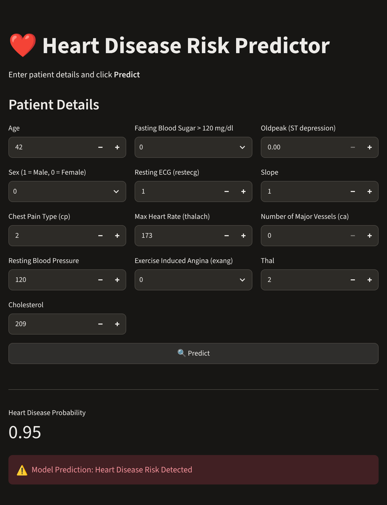
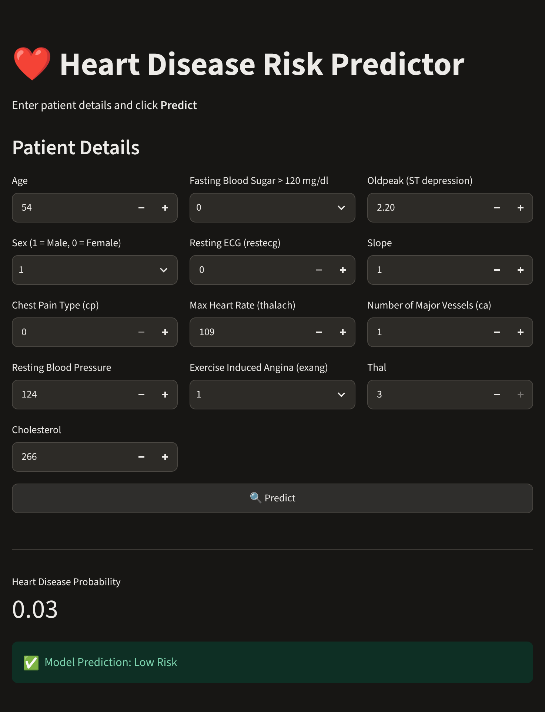

# Dr.ML - Multi-Disease Predictor

Dr.ML predicts whether a patient is likely to have **diabetes** or **heart disease** from a few clinical values. You type the values into a Streamlit page, the page sends them to a FastAPI backend, and the backend replies with a prediction and a probability from a trained scikit-learn model.

> This is a learning project. It is not a medical tool and should not be used to make health decisions.

## Screenshots

These were taken from the running app. Each set of values comes from a row the model did not see during training (the 15% test split), and the model got that row right.

**Home page**


**Diabetes predictor**

| Diabetes detected | No diabetes |
|---|---|
|  |  |
| Pregnancies 8, Glucose 151, Blood Pressure 78, Skin Thickness 32, Insulin 210, BMI 42.9, Pedigree 0.52, Age 36 → probability **0.85** | Pregnancies 1, Glucose 89, Blood Pressure 76, Skin Thickness 34, Insulin 37, BMI 31.2, Pedigree 0.19, Age 23 → probability **0.04** |

**Heart disease predictor**

| Heart disease risk detected | Low risk |
|---|---|
|  |  |
| age 42, sex 0, cp 2, trestbps 120, chol 209, fbs 0, restecg 1, thalach 173, exang 0, oldpeak 0.0, slope 1, ca 0, thal 2 → probability **0.95** | age 54, sex 1, cp 0, trestbps 124, chol 266, fbs 0, restecg 0, thalach 109, exang 1, oldpeak 2.2, slope 1, ca 1, thal 3 → probability **0.03** |

The probability is the model's score for the "disease" class. The app shows the warning message when the model's class prediction is 1 and the green message when it is 0.

## How it works

```
Streamlit page  --POST /api/predict-->  FastAPI  -->  saved model (.joblib)  -->  prediction + probability
(src/frontend)                          (src/backend)  (model_dir)
```

- **Frontend** (`src/frontend`): `app.py` is the home page and `pages/` holds one page per disease. Each page collects the inputs and calls the API address given in `API_URL`.
- **Backend** (`src/backend`): FastAPI with two routes, `GET /api/health` and `POST /api/predict`. The two models are loaded once when the server starts.
- **Training** (`src/training`): one script per disease. The model settings are kept in `config/best_hyperparameters.yaml`, and everything else (paths, test size, random state) comes from `.env`.
- **Common** (`src/common/preprocessing_util.py`): turns the zeros in some diabetes columns into missing values before the model sees them.

## Models

| | Diabetes | Heart disease |
|---|---|---|
| Data | `dataset/diabetes.csv`, 768 rows, 8 inputs, 34.9% positive | `dataset/heart.csv`, 1025 rows (only 302 are different), 13 inputs, 51.3% positive |
| Model | SVC (C=1.0, gamma=scale, class_weight=balanced) | Random Forest (1119 trees, max_depth 5, min_samples_split 30, min_samples_leaf 11, max_samples 0.6) |
| Preprocessing | 0 in Glucose, BloodPressure, SkinThickness, Insulin and BMI is treated as missing, filled with the median, then scaled | Standard scaling |
| Split (15% test) | Stratified split, `random_state=42` | Group split, so identical rows stay on the same side |
| Test rows | 116 | 156 (only 46 different) |
| Accuracy | 0.750 | 0.814 |
| Precision | 0.608 | 0.796 |
| Recall | 0.775 | 0.897 |
| F1 | 0.681 | 0.843 |
| ROC AUC | 0.830 | 0.894 |
| Train accuracy | 0.818 | 0.901 |
| Accuracy if it always guessed the common class | 0.651 | 0.513 |

Precision, recall and F1 are for the "disease" class. These numbers come from running the two training scripts with the settings in `env_template.txt`; the saved models in `model_dir/` give the same probabilities.

Two things to keep in mind when reading them:

- The heart dataset has many repeated rows. The training script keeps identical rows together on one side of the split so the test score is not inflated, but that leaves only 46 different patients in the test set. Treat 0.81 as a rough number.
- In the diabetes model, entering **0** for Glucose, Blood Pressure, Skin Thickness, Insulin or BMI means "unknown" and the model fills it in with the median value from the training data.

The notebooks in `Notebook_dir/` use their own splits (80/20 for diabetes, 85/15 for heart), so their scores are a little different from the table above.

## Inputs

**Diabetes** (`diabetes` in the API): Pregnancies, Glucose, BloodPressure, SkinThickness, Insulin, BMI, DiabetesPedigreeFunction, Age.

**Heart disease** (`heart_disease` in the API): age, sex (1 = male, 0 = female), cp (chest pain type, 0-3), trestbps (resting blood pressure), chol (cholesterol), fbs (fasting blood sugar > 120 mg/dl, 0/1), restecg (0-2), thalach (max heart rate), exang (exercise induced angina, 0/1), oldpeak (ST depression), slope (0-2), ca (major vessels, 0-4), thal (0-3).

## API

Start the backend and open `http://127.0.0.1:8000/docs` to try it in the browser, or use curl:

```bash
curl http://127.0.0.1:8000/api/health
# {"status":"ok","message":"API is healthy and running"}

curl -X POST http://127.0.0.1:8000/api/predict \
  -H "Content-Type: application/json" \
  -d '{"disease":"diabetes","features":{"Pregnancies":8,"Glucose":151,"BloodPressure":78,"SkinThickness":32,"Insulin":210,"BMI":42.9,"DiabetesPedigreeFunction":0.52,"Age":36}}'
# {"disease":"diabetes","prediction":1,"probability":0.8515...}
```

For heart disease send `"disease":"heart_disease"` with the 13 heart inputs listed above.

If the body is missing a field or has the wrong type, FastAPI answers with `422`. If the disease name is not `diabetes` or `heart_disease`, or a feature name is missing or misspelled, the API currently answers with `500`.

## Run it on your computer

You need Python 3.12 or newer (the versions in `requirements.txt` need it).

```bash
git clone https://github.com/bharathhottin/Dr.ML-Multi-Disease-Predictor.git
cd Dr.ML-Multi-Disease-Predictor

python -m venv .venv
.venv\Scripts\activate          # Linux/macOS: source .venv/bin/activate
pip install -r requirements.txt

copy env_template.txt .env      # Linux/macOS: cp env_template.txt .env
```

Open `.env` and set `PROJECT_ROOT` to the full path of the project folder. On Windows use forward slashes, for example `PROJECT_ROOT="C:/Users/you/Dr.ML-Multi-Disease-Predictor"`. With backslashes the path gets damaged, because a backslash followed by a letter inside quotes is read as a special character.

The trained models are already in `model_dir/`, so you can start straight away. Run these from the project folder, each in its own terminal:

```bash
uvicorn src.backend.main:app --reload     # API  -> http://127.0.0.1:8000
streamlit run src/frontend/app.py         # app  -> http://localhost:8501
```

To train the models again (this overwrites the files in `model_dir/` and writes the scores to `logs/app.log`):

```bash
python -m src.training.diabetes
python -m src.training.heart_disease
```

Restart the API after training, because it loads the models only once at start-up.

## Deploy on AWS EC2

The same app runs on an EC2 server using `deploy_drml.sh`. The script installs the packages, clones the repo, creates the virtual environment, writes `.env`, and starts the API on port 8000 and Streamlit on port 8501. The same commands are listed in `deployment_steps.txt`.

**1. Launch the instance (AWS console)**

- Choose **Ubuntu Server 24.04 LTS**. The script uses `apt-get`, so it has to be Ubuntu or Debian, and 24.04 gives Python 3.12, which the pinned packages need (the Python 3.10 on Ubuntu 22.04 cannot install them).
- Create a key pair and download the `.pem` file.
- In the security group, add these inbound rules:
  - SSH, port **22**, source **My IP**
  - Custom TCP, port **8501**, so the browser can open the app
  - Custom TCP, port **8000** only if you want to call the API from outside. The app itself talks to the API from inside the server, so 8000 does not have to be open.

**2. Connect from your computer**

```bash
ssh -i "your-key.pem" ubuntu@<EC2_PUBLIC_IP>
```

**3. Save the GitHub details on the server**

```bash
nano ~/.drml_secrets
```

```
GIT_REPO_URL=https://github.com/<your-user>/<your-repo>.git
GITHUB_USERNAME=<your-github-username>
GITHUB_TOKEN=<your-github-token>
BRANCH=main
```

```bash
chmod 600 ~/.drml_secrets
```

**4. Add the deploy script**

Paste the contents of `deploy_drml.sh` into a new file, or copy it from your computer with `scp -i "your-key.pem" deploy_drml.sh ubuntu@<EC2_PUBLIC_IP>:~/`.

```bash
nano deploy_drml.sh
chmod +x deploy_drml.sh
```

**5. Run it**

```bash
./deploy_drml.sh
```

**6. Check that it works**

```bash
curl http://127.0.0.1:8000/api/health
ps aux | grep -E "uvicorn|streamlit" | grep -v grep
tail -n 50 ~/dr-ml/api.log
tail -n 50 ~/dr-ml/ui.log
```

Then open `http://<EC2_PUBLIC_IP>:8501` in your browser.

**Updating later:** push your changes to GitHub, connect with SSH, and run `./deploy_drml.sh` again. It pulls the latest code and restarts both processes.

**Good to know**

- The two processes are started with `nohup`, not as services, so they stop if the server reboots. Run `./deploy_drml.sh` again to bring them back.
- The public IP changes when the instance is stopped and started, unless you attach an Elastic IP.
- The app is served over plain HTTP.
- `~/.drml_secrets` holds your GitHub token, so keep it at `chmod 600` and never commit it.
- The script writes `best_hyperparams.yaml` into the server's `.env`, but the real file is `src/training/config/best_hyperparameters.yaml`. The API does not read that setting, so deployment works. It only matters if you retrain on the server; then fix the file name in `.env` first.

## Troubleshooting

| Problem | What to check |
|---|---|
| "Unable to reach prediction service" on a page | The API is not running, or `API_URL` in `.env` is wrong |
| `ValidationError ... Field required` when starting | `.env` is missing, or you started the app from a different folder (it is read from the folder you run the command in) |
| Model file not found | `PROJECT_ROOT` in `.env` is wrong |
| Page opens locally but not on EC2 | Port 8501 is not open in the security group |
| `500` from `/api/predict` | Disease name or feature names do not match the lists above |
| Errors during `pip install` on the server | The server has an older Python; use Ubuntu 24.04 |

Logs go to `logs/app.log` on your computer and to `api.log` and `ui.log` in `~/dr-ml` on EC2.

## Project structure

```
Dr.ML-Multi-Disease-Predictor/
├── Notebook_dir/                      # experiments for both diseases
├── dataset/                           # diabetes.csv, heart.csv
├── model_dir/                         # saved pipelines (.joblib)
├── assets/screenshots/                # pictures used in this README
├── src/
│   ├── backend/                       # FastAPI: main.py, api/, schemas/, services/, config/
│   ├── frontend/                      # Streamlit: app.py, pages/, config/
│   ├── training/                      # diabetes.py, heart_disease.py, config/
│   └── common/preprocessing_util.py
├── env_template.txt                   # copy to .env and fill in
├── requirements.txt
├── deploy_drml.sh                     # EC2 deploy script
└── deployment_steps.txt               # EC2 commands
```

## Built with

Python, pandas, NumPy, scikit-learn, XGBoost (notebooks), FastAPI, Uvicorn, Pydantic, Streamlit, joblib, AWS EC2.
